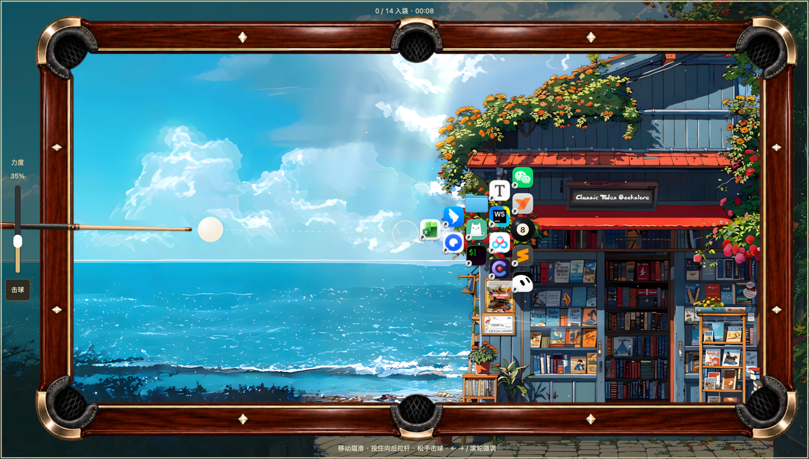

# 桌面图标台球 · Desktop Icon Billiards

使用真实桌面文件图标玩台球。当前开发版本采用 **Rust + Tauri 2**，提供 Windows Explorer 与 macOS Finder 适配，共用 Rust 物理引擎和 Canvas 界面。


## 开发运行

安装 [Rust](https://rustup.rs/)、Node.js LTS，并准备 Tauri 平台依赖：

- **Windows 10/11 x64**：Visual Studio Build Tools（Desktop development with C++、Windows SDK）和 Microsoft Edge WebView2。
- **macOS**：Xcode Command Line Tools（`xcode-select --install`）。首次读取桌面时，在系统提示中允许本应用控制 Finder；拒绝后可在「系统设置 → 隐私与安全性 → 自动化」调整。使用 `npm run dev` 时，权限可能归属启动应用的终端，请检查该终端下的 Finder 开关。Finder 查询等待最多 30 秒，图标准备等待最多 45 秒；超时后可检查权限并重试。

```sh
npm ci
npm run dev
```

Windows 也可以双击 `run.cmd`。游戏不再需要 Python、Tk 或 PyInstaller。

## 玩法

1. 点击「开始桌面游戏」读取真实桌面图标并打开台面。当前仅保留桌面游戏入口。
2. 每局从桌面**随机抽 14 个图标**作为目标球，另有一颗**黑 8** 固定在球阵中央。
3. 在台面移动鼠标瞄准，按住左键向后拉杆，松手击球。辅助线显示首次碰撞及白球／目标球的后续方向。
4. 六个袋口均可进球；白球入袋后稍候片刻，点击台面空处自行摆球（白球不会自动摆回）。
5. **先清完 14 个图标球，最后打进黑 8 获胜**；黑 8 提前入袋立即判负并停止计时，可在控制面板重新开局（重新随机发球）。
6. 用控制面板切换辅助线、重新开始或结束本局。按 `Esc`、全局快捷键 `Ctrl+Alt+X` 或点击「退出」关闭应用。

台面覆盖主显示器工作区，位于普通应用窗口下方。原始桌面图标不移动、不隐藏、不更改排列设置，关闭应用或进程异常退出后，系统移除游戏窗口，原桌面仍在。分辨率、缩放或工作区变化后需结束本局并重开。多显示器下汇集桌面项目，在主显示器游戏。

## 构建和检查

在对应平台构建：

```sh
npm run build
npm test
npm run check
cargo fmt --manifest-path src-tauri/Cargo.toml --check
```

Windows 也可以运行 `pwsh -File build.ps1`；依赖已装好时加 `-SkipDeps`。

- macOS 包：`src-tauri/target/release/bundle/macos/Desktop Icon Billiards.app`，默认当前架构。只构建 `.app`：`npm run build -- --bundles app`。
- Windows 原生构建包：`src-tauri/target/release/bundle/` 内的 MSI / NSIS 安装包；需要 Windows 原生构建工具。macOS 上也可使用 MinGW 交叉构建 x64 GNU EXE 与 NSIS：`npm run build -- --target x86_64-pc-windows-gnu --bundles nsis --ci`（需安装对应 Rust target、`mingw-w64` 与 `makensis`；交叉构建不替代 Windows 实机验收）。
- 正式 macOS 分发需签名、公证；当前本地构建不代表已签名发布。Apple Events entitlement 与权限说明已配置。

## 本地打包产物（0.1.1）

当前修正版包已保存到 `dist/`（包含 T-028 Windows 台面创建死锁修复，具体源码提交见 `dist/BUILD-INFO.txt`）：

- Windows：运行 `Desktop Icon Billiards_0.1.1_x64-setup.exe` 安装，之后从快捷方式启动。缺少 WebView2 Runtime 时安装器会尝试联网下载。
- Windows 免安装：完整解压 `DesktopIconBilliards_0.1.1_windows_x64.zip`，运行 `DesktopIconBilliards.exe`，保持 `WebView2Loader.dll` 在同一目录；需要 WebView2 Runtime。
- macOS Apple Silicon：打开 `Desktop Icon Billiards_0.1.1_aarch64.dmg`，将应用拖入 Applications。仅有本地 ad-hoc 签名，未做 Developer ID 签名／公证；不包含 Intel 架构。
- 校验文件：`dist/SHA256SUMS.txt`。Windows 包尚未实机验收，两个平台均未公开发布。启动后点击「开始桌面游戏」，桌面需至少 14 个图标。

## 代码与迁移范围

- [PRODUCT.md](PRODUCT.md)：迁移需求与边界。
- [DEVELOPMENT.md](DEVELOPMENT.md)：Rust 模块、平台适配和与旧版的差异。
- [TASKS.md](TASKS.md)：任务和验收状态。
- [VALIDATION.md](VALIDATION.md)：实际验证证据。

旧 Python 产品、测试、依赖、打包入口及更新清单已移除，迁移对照可通过 Git 历史（基线提交 `db053ad`）查阅。旧版下载可在 [上游发布页](https://github.com/liuxiaogang-com/desktop-icon-billiards/releases) 查找。应用图标原始素材保留在 `assets/icon-source.png`，不随前端资源打包；`tools/make_icon.py` 可从当前 PNG 生成 ICO（需要 Pillow）。

当前应用不截屏、不采集音频、不主动请求网络；只读取桌面项目名并通过系统接口提取图标。没有自动更新下载行为。

## 致谢

本项目借鉴并延用了 [liuxiaogang-com/desktop-icon-billiards](https://github.com/liuxiaogang-com/desktop-icon-billiards) 的核心玩法与设计思路——用真实桌面文件图标打台球、桌面即球台、图标不动而球动。Rust + Tauri 版本是在其 Python 原版（`app.pyw`、`dib/`）基础上的重写与迁移，物理规则、状态机与交互习惯均承自原项目。感谢原作者 LXG 的开源工作。

## 许可证

[MIT](LICENSE) · Copyright (c) 2025–2026 LXG


## 磁盘占用

可运行应用保存在 `dist/Desktop Icon Billiards.app`。构建缓存位于 `src-tauri/target/`，Node 依赖位于 `node_modules/`；本轮清理未删除这些缓存与依赖。缺少 Node 依赖时运行 `npm ci`。

Cargo 开发／测试配置关闭调试符号和增量缓存，发布配置剥离符号。依赖仍需编译，后续构建缓存仍会增长，这些设置不能保证 Rust 编译目录始终只有几 MB。保留应用后可运行 `cargo clean --manifest-path src-tauri/Cargo.toml`。

功能与验证入口：[FEATURE_MAP.md](FEATURE_MAP.md)、[项目本地验证 skill](.agents/skills/verify-desktop-billiards/SKILL.md)。
